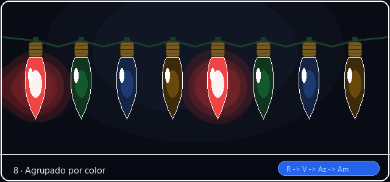

# Focos C7 Studio — ESP8266

Controlador Wi-Fi de **8 canales** para serie de luces **Holiday Time (8 Focos LED Jumbo C7)** con **ESP8266**. Incluye estudio web **Liquid Glass** con simulador en vivo, **14 secuencias de iluminación**, cambio de red Wi-Fi desde el navegador, receptor **xLights (DDP)** y actualizaciones **Cloud OTA** directo desde GitHub.

---

## Vista previa

  
  

    Haz clic en la vista previa para abrir el <strong>Estudio Web en vivo</strong>, probar los 14 efectos sobre la serie de 8 focos (Rojo, Verde, Azul, Amarillo × 2), buscar tu ESP8266 en la red local o actualizarlo por OTA.
  

---

## Características

- **Estudio Web Liquid Glass en GitHub Pages:** Todo el apartado visual corre en el navegador ([`index.html`](index.html)) sin saturar la memoria del ESP8266, e incluye un panel local ligero de respaldo en `/` con acceso directo al estudio completo.
- **Vista previa fiel a los focos físicos:** Simula los 8 focos jumbo C7 en su orden físico (**Rojo → Verde → Azul → Amarillo × 2**) con opción para **invertir la dirección (8 → 1)** según cómo hayas colgado la serie.
- **14 modos de iluminación sin tirones sin internet:** El ciclo principal (`loop()`) nunca hace peticiones bloqueantes a la red; si se cae el Wi-Fi o no hay internet, las secuencias siguen corriendo al 100% de fluidez.
- **Wi-Fi configurable desde la web + red de respaldo:** Escanea redes cercanas desde GitHub Pages, cambia de Wi-Fi sin recompilar y levanta automáticamente su red propia **`FocosC7`** (`192.168.4.1`) si no encuentra el módem.
- **Cloud OTA por GitHub (BearSSL):** Descarga e instala `firmware.bin` desde GitHub optimizando los buffers TLS (`1024/512`) mientras los 8 focos funcionan como barra física de progreso (`0% → 100%`).
- **Compatible con xLights (DDP):** Escucha paquetes UDP en el puerto `4048` (8 canales *Single Color*, `> 127` enciende) y vuelve automáticamente al patrón guardado a los `2 s` de detener el show.

---

## Modos de iluminación (`0–13`)

| ID | Nombre | Categoría | Descripción |
| :---: | :--- | :--- | :--- |
| **`0`** | **Apagar** | Clásico | Apaga los 8 canales de la serie. |
| **`1`** | **Persecución** | Clásico | Un foco encendido recorre del canal 1 al 8. |
| **`2`** | **Ping-pong** | Clásico | Vaivén continuo de extremo a extremo. |
| **`3`** | **Alternado** | Clásico | Intercala focos pares e impares. |
| **`4`** | **Llenar y vaciar** | Clásico | Acumula del 1 al 8 y los apaga en secuencia. |
| **`5`** | **Chispas** | Clásico | Destellos aleatorios por toda la serie. |
| **`6`** | **Parpadeo** | Clásico | Enciende y apaga los 8 focos al mismo tiempo. |
| **`7`** | **Encender todo** | Clásico | Iluminación fija continua en toda la tira. |
| **`8`** | **Por color** | Nuevo | Agrupa físicamente los pares de color: **Rojos → Verdes → Azules → Amarillos**. |
| **`9`** | **Cortina** | Nuevo | Abre desde el centro (`4 y 5`) hacia las puntas (`1 y 8`) y regresa. |
| **`10`** | **Cometa triple** | Nuevo | Estela continua de 3 focos viajando juntos. |
| **`11`** | **Hueco viajero** | Nuevo | 7 focos encendidos con 1 sombra rebotando de punta a punta. |
| **`12`** | **Choque dual** | Nuevo | Dos haces salen de los extremos, chocan al centro y expanden una onda. |
| **`13`** | **Cascada espejo** | Nuevo | Llena simétricamente de extremos a centro y vacía a la inversa. |

---

## Hardware y conexiones (`D0–D7`)

Pensado para **ESP8266MOD (AI-Thinker ESP-12E / ESP-12F, 4 MB Flash)** —o placas basadas en él como NodeMCU / Wemos D1 Mini— conectado a un módulo de **8 relevadores de 5V activos en bajo** (o relevadores de estado sólido SSR):

| Canal lógico | Pin ESP8266 | GPIO | Color físico (Holiday Time C7) |
| :---: | :---: | :---: | :--- |
| **Foco 1** | `D0` | `GPIO 16` | Rojo |
| **Foco 2** | `D1` | `GPIO 5` | Verde |
| **Foco 3** | `D2` | `GPIO 4` | Azul |
| **Foco 4** | `D3` | `GPIO 0` | Amarillo |
| **Foco 5** | `D4` | `GPIO 2` | Rojo |
| **Foco 6** | `D5` | `GPIO 14` | Verde |
| **Foco 7** | `D6` | `GPIO 12` | Azul |
| **Foco 8** | `D7` | `GPIO 13` | Amarillo |

> **Nota electrónica:** Al apagar un canal, el firmware coloca el pin en `INPUT` (alta impedancia / flotante) y al encenderlo lo lleva a `OUTPUT + LOW`. Esto evita que los 3.3V del ESP8266 dejen parcialmente encendido un módulo de relevadores de 5V con optoacopladores.

---

## Cómo usar con Arduino IDE y publicar OTAs

No necesitas instalar librerías externas: solo el soporte oficial de **ESP8266** en Arduino IDE.

### 1. Primera carga por USB
1. Abre [`focos_c7/focos_c7.ino`](focos_c7/focos_c7.ino) (o copia el contenido de [`luces.txt`](luces.txt)) en **Arduino IDE**.
2. Selecciona la placa **NodeMCU 1.0 (ESP-12E Module)** (o **Generic ESP8266 Module** si usas la placa ESP8266 regular) con **Flash Size: `4MB (FS:2MB OTA:~1019KB)`** *(o `2MB (FS:256KB OTA:~892KB)` si tu chip trae 2 MB)*. El código incluye el mapeo `D0–D7` integrado para compilar en cualquiera de las dos opciones.
3. Opcionalmente deja `TU_WIFI` tal cual y configúralo después conectándote a la red **`FocosC7`** (clave `focos1234`, entra a `http://192.168.4.1`).
4. Compila y sube por cable USB.

### 2. Actualizar sin cables (Cloud OTA)
1. Haz tus cambios en `focos_c7/focos_c7.ino` y sube `FIRMWARE_VERSION`.
2. En Arduino IDE usa **Programa → Exportar binario compilado** (`Ctrl+Alt+S`) y sube el `.bin` como `firmware.bin` junto con `version.json` al repositorio (o ejecuta `python publicar_ota.py` para automatizar compilación, versión y subida).
3. Entra a **[alexgremory255.github.io/focos-c7/](https://alexgremory255.github.io/focos-c7/)**, selecciona tu controlador y haz clic en **Sistema y OTA → Actualizar por OTA**.
